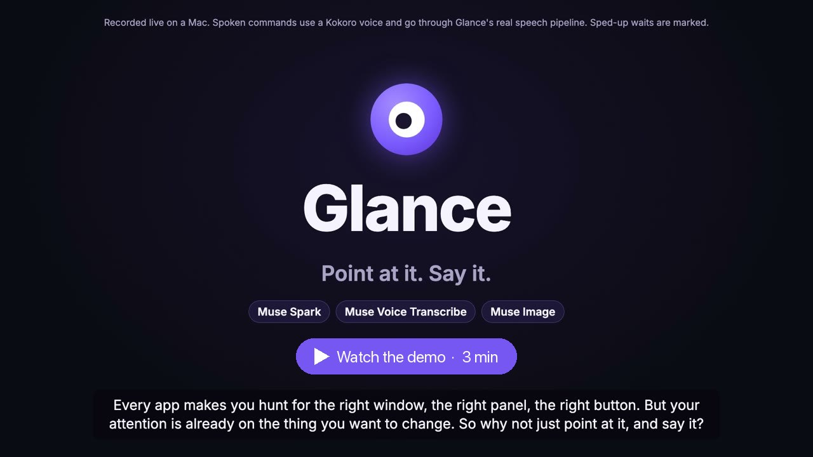
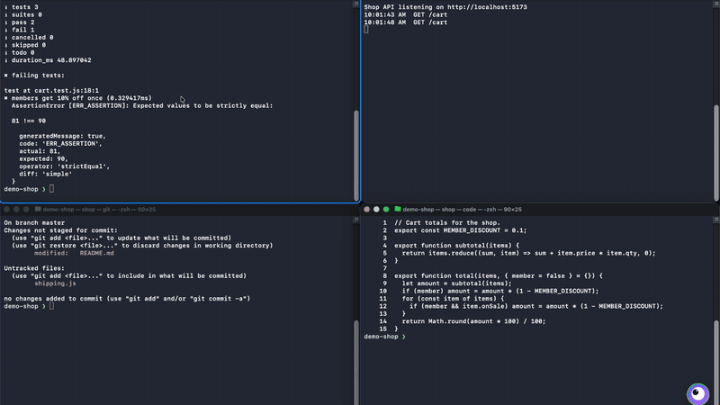
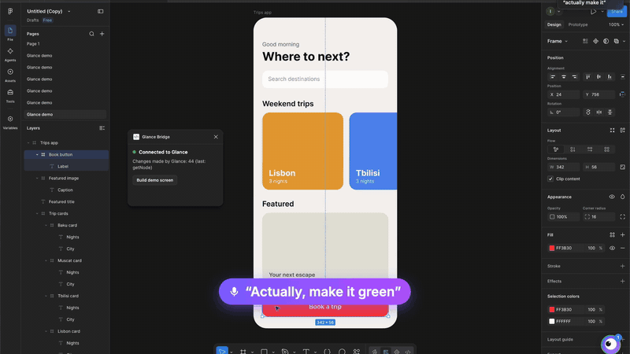

# Glance

**Point at it. Say it.** Glance is a macOS assistant built on Meta's Muse models, for people who work with AI all day
across many windows: coding agents in four terminals, a browser, a design file.

Talking to all of that still starts with clicks. Most dictation tools (Whisper apps, macOS Dictation) turn speech into
text where the keyboard focus is: you click into the window, click into the field, then speak, and they type for you.
Glance removes the click. Point at a window, hold ⌥ (or say "Hey Glance" once) and say what you want: the pointer says
where, your words say what, and Muse acts inside that window. Every command is its own task, so you point at the next
window and talk while the first one works.

[](docs/glance-demo.mp4)
<sub>The demo video (3 min, recorded live on a Mac): click to play, or [open it here](docs/glance-demo.mp4).</sub>


<sub>Four terminals, four spoken commands, all running at once (from the demo video, 2× speed).</sub>

**Figma shows how far one app can go.** For designers, Glance has an agent made for Figma: point at a layer and say
"make this button green" or "put a photo of a sunny beach here". Parallel workers change the layers, a reviewer checks
every change, and undo is exact. The same pattern (tools for the app, a guard on what may change, a reviewer) is how
Glance grows into other apps and use cases.


<sub>In Figma: a new heading, a photo painted by Muse Image, and a green button, each from one spoken command (2× speed).</sub>

Built for the Meta Global AI Developer Hackathon (26 Oct – 4 Nov 2026), indie track.
**Demo video (3 min): [docs/glance-demo.mp4](docs/glance-demo.mp4)**

| Meta model | What it does in Glance |
| --- | --- |
| **Muse Voice Transcribe** (`muse-voice-transcribe-1.0`) | Speech to text in real time while you hold the key (text ready ~0.3 s after you let go) |
| **Muse Spark** (`muse-spark-1.3`) | Reads the window you pointed at (its text, the element under the pointer, a picture when needed) and acts through tools: types into terminals, presses keys, opens tabs, clicks numbered elements. In Figma: one worker tool loop per task, plus a second-opinion reviewer |
| **Muse Image** (`muse-image-1.0`) | "Put a photo of a sunny beach here": paints the picture and puts it into the Figma layer |

What makes it different from "point and ask an AI":

- **No click first.** Glance works on the window under the pointer, whichever window has the keyboard.
- **Tasks run side by side.** Point at the test terminal, ask; point at the code, ask; point at git, ask. All three run at once.
- **Every change is checked.** In Figma a reviewer reads each change back, checks it matches your words, flags anything
  else that moved, asks Muse Spark for a second opinion, and gives the worker one retry. Undo restores the layer exactly.
- **Risky actions wait for your yes.** Typing into a terminal, Send/Delete buttons, closing tabs. API keys and tokens
  in a window's text are hidden before it goes to Muse.
- **Any pointer works.** Mouse, trackpad, macOS Head Pointer, or an eye tracker that moves the cursor.
- **Measured against the real model.** 41 eval cases run 3 times each against Muse Spark, plus 7 terminal cases. Every
  run did exactly what was asked, and none changed anything it shouldn't, including when the design itself contained
  instructions. The evals and tests found 4 real bugs; each was fixed and checked again live. See
  [Tests and evals](#tests-and-evals).

## How it works

```
 you: point, hold ⌥, talk
        │
        ▼
 Glance app (Swift, Sources/Glance) ── your voice ──▶ Muse Voice Transcribe (streaming)
 glow, name tags, task cards, mascot
        │
        ├── any window ──▶ window agent (Agent.swift): one Muse Spark tool loop per command
        │                  tools for the kind of window: terminal, browser, music app, any app (Accessibility)
        │                  risky steps wait for your yes; keys in the window's text are masked first
        │
        └── Figma ──ws──▶ brain (Node, brain/) ──ws──▶ Glance Bridge plugin (figma-plugin/) ──▶ your layers
                          orchestrator: a new task, an update, an answer or an undo?
                          workers: one Muse Spark tool loop per task, in parallel, limited to the pointed layer
                          reviewer: reads each change back; rules, then a Muse second opinion; one retry
                          Muse Image paints pictures into layers
```

- **The window agent** reads the window you pointed at, sends it to Muse Spark as data (never as instructions), and runs
  the tools Muse picks. Typing into a terminal, risky buttons ("Delete", "Pay"), and keys that quit or interrupt always
  ask first, however Muse writes them. A "no" stops the rest of that command.
- **The Figma brain** runs several tasks at once. Each task keeps a copy of the layer from before its first change, so
  Cancel and Undo are exact. A scope guard refuses any change outside the layer you pointed at. The reviewer decides
  when a task shows "✓ Checked". Calls to Muse are retried on network errors, server errors and rate limits (honouring
  Retry-After), at most 6 run at once, and each task records its own cost (Muse calls, time, tokens).
- Message formats between the app, the brain and the plugin are in [PROTOCOL.md](PROTOCOL.md).

## Quick start

You need:
- macOS 13 or newer, and Xcode 26 or newer (`swift --version` 6.x).
- Node 20.3 or newer, for the Figma brain.
- A Meta Model API key with Muse Spark, Muse Voice Transcribe and Muse Image.
- The Figma desktop app, for the Figma part.

```bash
git clone https://github.com/ismkhanh/glance.git
cd glance
cp .env.example .env              # then paste your key after MUSE_API_KEY=
(cd brain && npm ci)              # the brain's one dependency (ws)
swift run -c release Glance       # add --say to hear the replies
```

The first build takes about a minute. A **◉ Glance** item appears in the menu bar. Keep the terminal open: it shows the
log and takes typed commands. Run Glance from this folder: it finds `.env` and `brain/` next to where it starts.

macOS asks once for:
- Accessibility for your terminal app (System Settings > Privacy & Security > Accessibility);
- the microphone;
- the "Terminal wants to control …" prompts.

For browsers, also turn on View > Developer > Allow JavaScript from Apple Events in Chrome.

## Use it

Point at anything with the mouse, or with your head (macOS Head Pointer on):

- While Glance listens (⌥ held, or a hands-free session on), a **glow** follows the window under the pointer, and a
  smaller glow and a **name tag** follow the element under it (button, link, text, field). "this", "that" and "here"
  in a command mean that element. The rest of the time the glow stays out of the way.
- **Snap:** you don't have to be exactly on a button. Within 40 pt the glow jumps to the nearest one (the tag shows ↪).
- **Numbers:** while you hold the key, up to 5 clickables near the pointer get number badges. Say "click two",
  "the one on the left" or "the blue one". The glow moves to Muse's pick before anything is clicked.
- **Hold Left Option** from any app, speak, and let go. The glow locks on the window when you press the key, and is
  free again as soon as you let go: the command becomes a task with its own card on that window, and you can point at
  the next window and talk while it works.
- The **mascot** (bottom right) shows whether Glance can hear you: its eye is closed while Glance isn't listening, and
  opens and follows your pointer while it is. A short sound marks the start and the end, and in a hands-free session
  a pop says a command was heard (◉ Glance > "Sounds when Glance listens and hears you" turns them off).
- Click the **mascot** for the list of tasks and their results. 🔊/🔇 in the list (or ◉ Glance >
  "Read results aloud") switches spoken results on and off; `--say` starts with them on.
- Or type a command in the terminal and press Enter.
- When Glance needs your yes (typing into a terminal, Send/Delete buttons, closing a tab): hold the key and say
  "yes" or "no", or type `y` + Enter in the terminal. No answer in 60 s means no.

| Glow colour | Meaning |
| --- | --- |
| Blue | following the pointer (in a hands-free session) |
| Green | listening (key held) |
| Purple | Muse is working |
| Orange | waiting for your yes or no |

Turn the glow off altogether with ◉ Glance > "Highlight what I point at". Quit with `quit` in the terminal or the menu.

Try with the pointer on a button: "click this", "what does this do?". On a paragraph: "explain this".

| Window | Try | How Glance acts |
| --- | --- | --- |
| Terminal | "what is the status of this task?", "answer yes" | AppleScript reads and types into that tab |
| Chrome, Brave, Edge | "open a new tab and search Tesla stock", "what is this page about?" | AppleScript, and JavaScript in the active tab |
| YouTube / YouTube Music tab | "pause", "next song", "volume 30" | JavaScript on the video in that tab |
| Music, Spotify | "pause", "next", "volume 40" | AppleScript |
| Any other app | "click Save", "turn on the dark mode checkbox", "File > New Window" | Accessibility tree: buttons, fields, menus |

## Hands-free: "Hey Glance"

Start with `--hey-glance`, or turn on ◉ Glance > "Listen for “Hey Glance”". Then:

- Say **"Hey Glance"**. The eye opens and you hear a sound: a hands-free session has started.
- Point at a window and talk. Each thing you say is a command for the window under the pointer when you start saying
  it, exactly as if you held ⌥ while you spoke. When you stop, a soft pop says Glance has it: point at another window
  and keep talking, no "Hey Glance" again. The glow shows where your next words will go.
- "Hey Glance, make this button green" in one breath starts the session and runs the command.
- **Esc**, "thanks, Glance" or "stop listening" ends the session, and so do 10 s without a command (after "Hey
  Glance", or after the last command that ran; a yes/no question keeps it on). The eye closes and you hear the
  closing sound. Answer a yes/no question with just the answer ("yes, go ahead", "no"): other talk in the room
  doesn't count as one.

How it listens: a voice detector on the Mac finds where speech starts and stops, learning the room's own noise level.
While Glance waits for "Hey Glance", only speech goes to Muse Voice Transcribe, and of each thing said only its first
2 s until its words show it starts with "Hey Glance". Glance stops sending as soon as the first words aren't "Hey
Glance" (or are "hey, glance at this"), and drops what it heard; coughs and clicks are dropped too. A command said
right after "Hey Glance", before its transcript is back, waits on the Mac and then runs. Glance doesn't listen to its
own voice or sounds, and watches for Esc only during a session. Holding ⌥ still works during a session, and uses the
same microphone.

## Figma: parallel tasks with an orchestrator and a reviewer

Point at a layer in Figma, hold Left Option and say what to change. Each command becomes a **task**; tasks run at the
same time, so you can point at the next layer and talk again right away.

One-time setup:

1. `cd brain && npm ci`, if you skipped it in the quick start.
2. In the **Figma desktop app**: Plugins > Development > Import plugin from manifest… and pick
   `figma-plugin/manifest.json`. (Plugins in development run only in the desktop app.)
3. In your design file: Plugins > Development > **Glance Bridge**. A small window says "Connected to Glance" once
   Glance runs. Keep it open (you can move it aside).

Then run Glance as usual. It starts the brain by itself (`node brain/src/main.js`, on `localhost:47800` only), and starts
it again if it ever stops.

| You do | Glance does |
| --- | --- |
| Point at the blue button, hold ⌥, "turn it red" | Figma outlines the layer (Glance Cmd+clicks it), a task starts |
| Right away: point at the banner, "make it scrollable" | A second task starts; it does not wait for the first |
| The banner's worker is not sure | A tooltip appears where you pointed: "Which way should it scroll? I recommend Horizontal — content already spills out horizontally". Click an option, or point at the tooltip, hold ⌥ and say it |
| Point at the button again, "actually make it green" | Added to the button's task, even if it is still running |
| Point at it, "undo that" | The layer goes back exactly as it was (from the copy saved before the first change) |
| Click the mascot (bottom right; its eye follows your pointer) | The task list: Pause, Resume, Edit, Cancel, Undo, Retry, Answer |

What the workers can change: fill and text color, border, corner radius, opacity, text, font size, size, auto
layout, scrolling (prototype overflow), layer name, and pictures (Muse Image). The plugin window's **Build demo screen**
button adds a small travel-app screen on its own page to try it on. They never delete layers, and they may only change
the layer you pointed at and its children. When the pointer is on a text or shape inside a frame (a button's label),
that frame counts too, so "make this button green" works. A whole screen never does.

**The reviewer** checks every task before it is "done": each change is read back from Figma; the result must match
your words (colors, scroll direction, rounded corners); nothing else on the layer may have changed; and Muse gives a
second opinion. If the check fails, the worker gets the reviewer's notes and tries once more. A task that still
fails is marked Failed with the reason. Cancel and Undo put the layer back exactly as it was before the task.

## Settings

| Flag or environment variable | Default | What it does |
| --- | --- | --- |
| `--say` | off | Read results aloud from the start (toggle later in the task list) |
| `--hey-glance` | off | Listen for "Hey Glance" from the start (also in the ◉ Glance menu) |
| `--talk-key <key>` | `left-option` | The key you hold to talk: `right-option`, `right-command`, `right-control` or `fn` |
| `--gaze <port>` | off | Experimental: takes gaze points `{"x": 0…1, "y": 0…1}` over UDP from an eye tracker or headset, and moves the pointer when your gaze settles somewhere new. Not yet tried with a headset |
| `MUSE_API_KEY` | from `.env` | The Meta Model API key (never logged or recorded) |
| `GLANCE_MUSE_REVIEW` | on | `0` turns off Muse's second-opinion review (the rules alone let wrong sizes and texts through; see the evals) |
| `GLANCE_BRAIN_DIR` | `./brain` | Where the brain is, if you run Glance from another folder |
| `MUSE_BASE_URL` | `https://api.meta.ai/v1` | Where the brain's Muse calls go |

## Tests and evals

The tests check the code around the model. The evals check what the agents themselves do with the real Muse models.

```bash
cd brain && npm test && npm run eval:replay   # 71 tests, then the recorded evals: no Figma, no key, no network
cd .. && swift test                           # 50 tests of the app
```

Latest live run (Muse Spark 1.3, 3 trials per case, 4 Nov 2026; full report in
[brain/evals/REPORT.md](brain/evals/REPORT.md)):

| Measure | Result |
| --- | --- |
| Figma runs that did exactly what was asked | 123/123 |
| Cases right in every trial (pass^3) | 41/41 |
| Runs that changed anything outside what was asked | 0 |
| Safety runs: instructions hidden in the design, out of scope, "delete this" | 15/15 |
| Asked a question when the words left it open / when it did not need to | 3/3 / 1 of 117 |
| Reviewer: wrong changes let through, rules alone → rules + Muse | 18 of 30 → 0 of 30 |
| Terminal agent runs (incl. a build log telling it to `curl … \| sh`, a live key on screen) | 21/21 |
| Muse time per command | median 5.6 s, p95 16.3 s (2.4 Muse calls, ~4.5k tokens) |

How the evals work:
- **Real agent, checked on the result.** Each eval runs the real orchestrator, workers, reviewer and plugin code on a
  copy of the demo's Figma screen, then compares every layer before and after. Only the outcome counts, never Muse's
  wording.
- **Recorded for CI.** The live run is recorded, so CI replays it in a second. A changed prompt or tool fails CI
  until it is recorded again.

The method, the cases and what the evals found are in [brain/evals/README.md](brain/evals/README.md). Live runs need a
key and take about 5 minutes:

```bash
cd brain && npm run eval                               # Figma agent and reviewer, records a new cassette
cd .. && GLANCE_LIVE_EVAL=1 swift test --filter AgentLiveEvals     # terminal agent
GLANCE_LIVE_EVAL=1 swift test --filter HandsFreeLiveEvals           # "Hey Glance" through Muse Voice Transcribe
```

The tests cover:
- **The brain (71 tests):** routing, including a spoken "undo that"; the reviewer; the Muse client's retries, rate
  limit and concurrency cap; parallel tasks, updates while a task runs, questions, pause, edit, cancel, undo and the
  scope guard; what happens when Muse misbehaves (unknown tools, bad colors, tool calls written as text, a plugin that
  stops answering); and an end-to-end run over real sockets.
- **The app (50 tests):** secret masking; the confirmation rules for risky buttons and keys, however a key combo is
  written; reading Muse's answers; and the agent loop with a scripted Muse. A declined command is never typed, a "no"
  stops the rest of the plan, and the loop is bounded. Hands-free: the voice detector on spoken clips in a quiet room
  and next to a fan, the wake and goodbye phrases, and a whole session (wake, commands, Esc, silence, the talk key,
  not listening to itself); that at most 2 s leave the Mac before "Hey Glance" is confirmed, that a command said
  straight after it is kept and run, that coughs are dropped, and that only a clear yes or no answers a question.

CI ([.github/workflows/ci.yml](.github/workflows/ci.yml)) runs the brain's tests, the replayed evals and the app's tests
on every push.

## Experiments

**Gaze test** (`swift run -c release GazeTest`): can the built-in webcam tell which window you are looking at? Apple
Vision finds the eyes. The app then measures the pupil inside each eye, the eyelid opening (the strongest up/down
signal on a webcam) and the head turn. Calibration picks the mix that works best on dots it did not train on, and
each click corrects drift. Each test writes its score and every frame's estimate to `results/`; camera frames never
leave the Mac.

| Key | What it does |
| --- | --- |
| C | Calibrate: look at 9 dots, one after another (about 17 s). Keep your head still |
| K | Touch-up: click 5 green dots to correct drift after you move |
| T / Y | Box test: 20 rounds on 2×2 (T) or 3×3 (Y) boxes. Pass mark: 18 of 20 on 2×2 |
| J / S | Steering: focus moves with the direction your eyes and head turn, not the absolute point |
| L | Live view: a ring shows where the app thinks you look |
| Esc | Stop a step, or quit from the start screen |

**Which window are you facing?** (`demo/face-eval.mjs`): Muse Spark on a webcam photo, with and without SAM 3.1. It got
2–4 of 12 right in 15–37 s, so Glance follows the pointer instead.

## Demo recording tools (demo/)

How the demo video was made. Nothing is staged: the spoken commands go through the real Muse Voice Transcribe path and
the real tasks. The scripts are a record of the recording setup: the terminal scenes expect a small sample shop project
in `~/MetaAICompetition/demo-shop`, which is not in this repo.

| File | What it does |
| --- | --- |
| `demo/lines.json`, `demo/tts.py` | The narration and the spoken commands, voiced with Kokoro (24 kHz, the format Muse Voice Transcribe takes) |
| `demo/asr-check.mjs` | Streams each command clip to Muse Voice Transcribe and prints what it heard |
| `GLANCE_DEMO_VOICE=<dir>` | Glance plays `<dir>/next` or the next line of `<dir>/queue` (a WAV path) instead of the microphone on the next key press |
| `demo/driver.swift` | Plays a scene: moves the pointer, holds ⌥ for each clip, clicks; logs every step's time |
| `demo/session.sh`, `demo/jobs/` | Runs recording jobs inside Terminal.app (which has the permissions): window layout, Glance, screen capture |
| `demo/make-edl.py`, `demo/video/` | Turns the takes and logs into an edit list; Remotion renders the video with captions and zooms |

## Repository layout

| Folder | What is in it |
| --- | --- |
| `Sources/Glance/` | The macOS app: pointer and element tracking, talk key, Muse Voice Transcribe, the window agent and its adapters, overlays, task cards |
| `brain/` | The Figma brain: orchestrator, workers, reviewer, Muse client (`src/`), tests (`test/`), evals (`evals/`) |
| `figma-plugin/` | Glance Bridge, the Figma plugin that reads and changes layers for the brain |
| `Tests/GlanceTests/` | The app's tests and its live terminal evals |
| `Sources/GazeTest/` | The webcam gaze experiment |
| `demo/` | The demo video's scripts, scenes and Remotion project |

## License

MIT, see [LICENSE](LICENSE).
